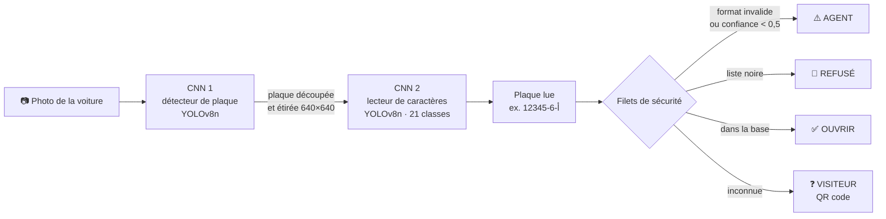
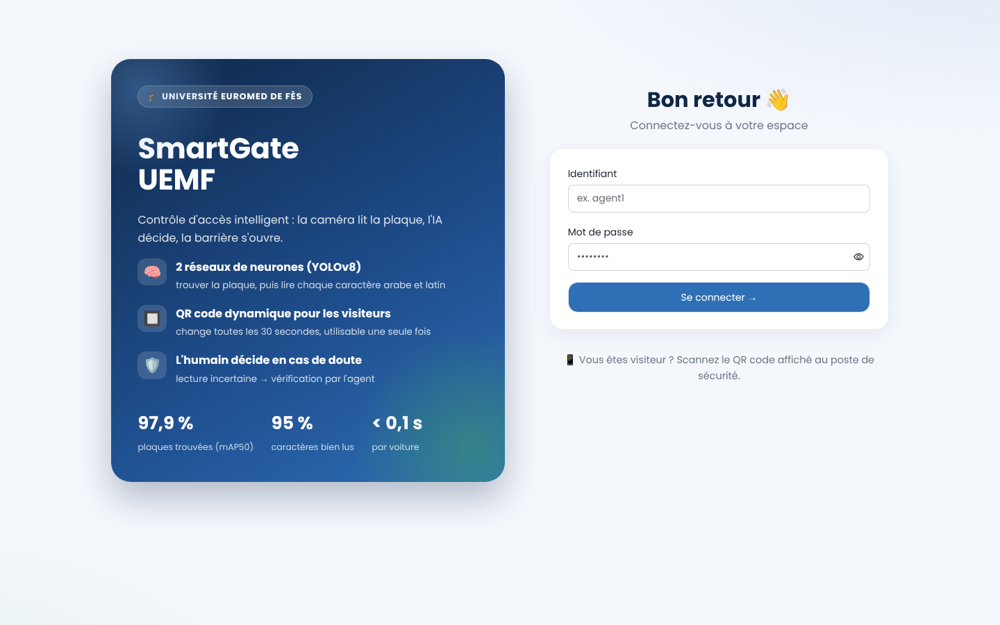
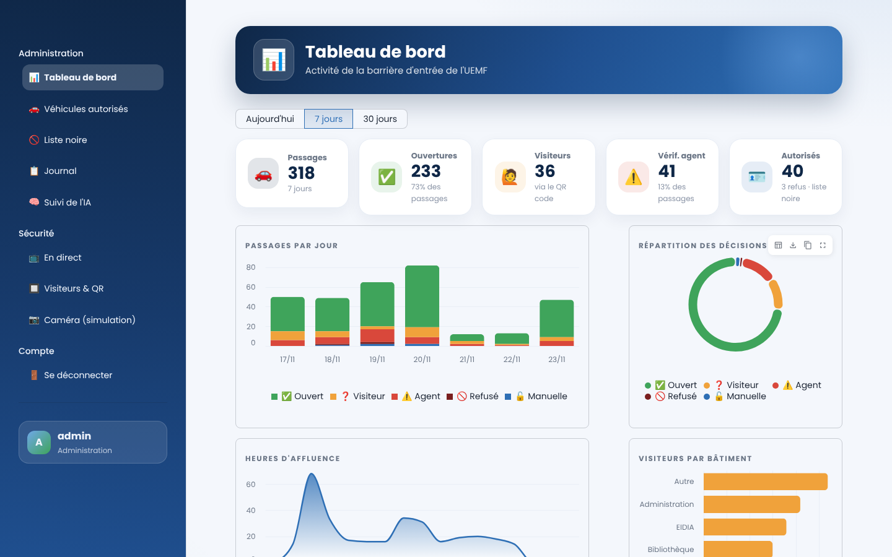
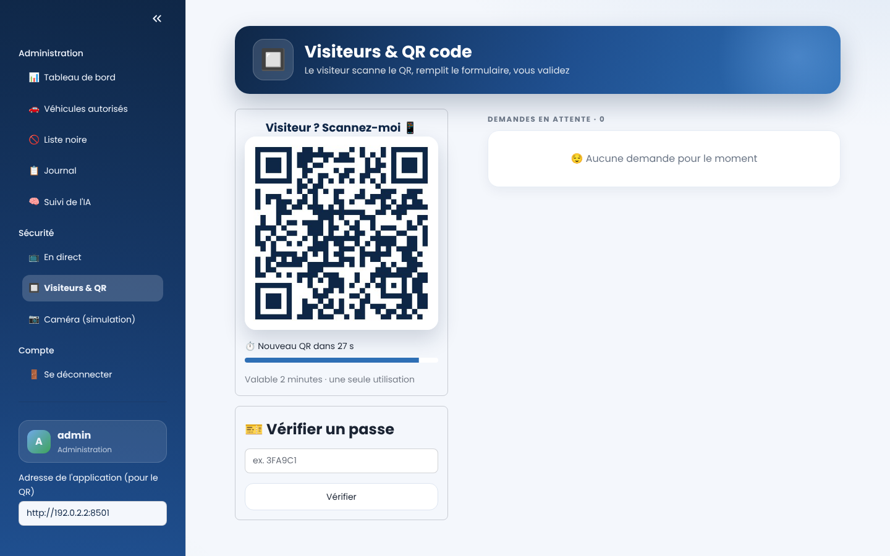
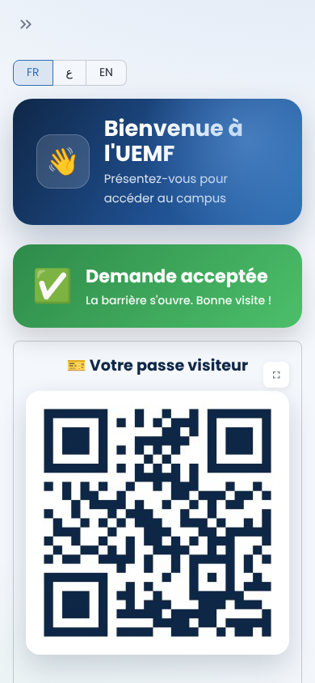
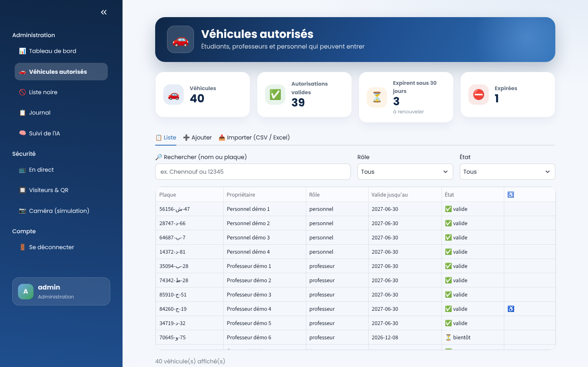
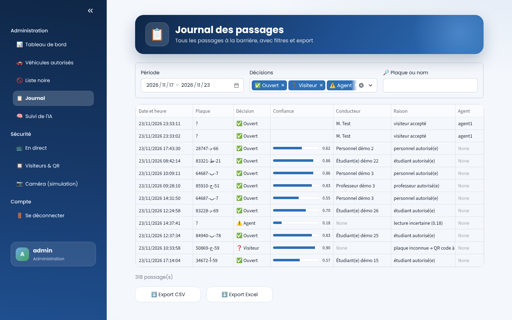
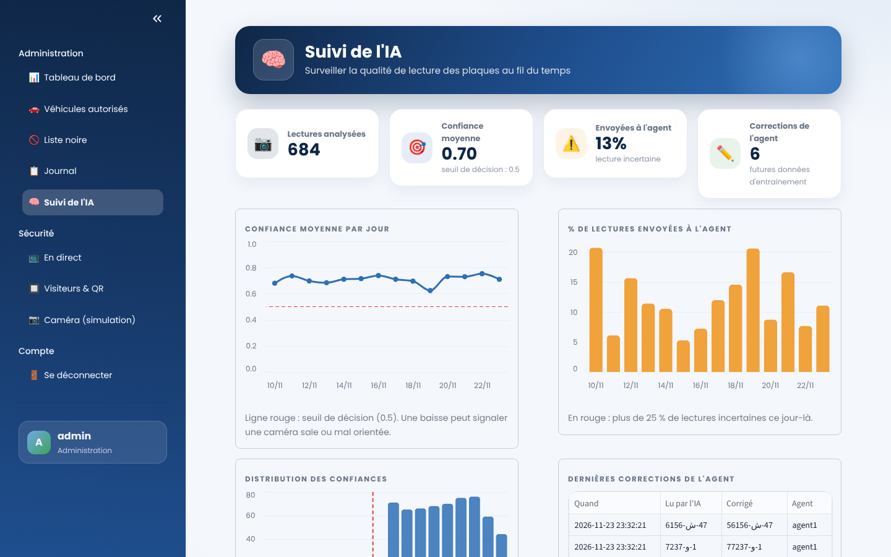

# 🚗 SmartGate UEMF

**Contrôle d'accès intelligent à l'entrée de l'Université Euromed de Fès** : une caméra lit la plaque d'immatriculation marocaine grâce à deux réseaux de neurones convolutifs (YOLOv8), une base de données décide si la voiture est autorisée, et la barrière s'ouvre. Les visiteurs s'enregistrent avec un **QR code dynamique**, et une application web sert trois profils : **Sécurité**, **Administration** et **Visiteur**.


> Projet du module **Réseaux de neurones convolutifs**, 4ᵉ année Ingénierie Digitale & Intelligence Artificielle, EIDIA – UEMF.

---

## 📌 Sommaire
1. [Comment ça marche](#-comment-ça-marche)
2. [Fonctionnalités](#-fonctionnalités)
3. [Captures d'écran](#-captures-décran)
4. [Résultats](#-résultats)
5. [Installation](#-installation)
6. [Structure du projet](#-structure-du-projet)
7. [Données et licences](#-données-et-licences)
8. [Limites et perspectives](#-limites-et-perspectives)

---

## 🧠 Comment ça marche



**Deux CNN entraînés par fine-tuning (transfer learning) de YOLOv8n :**

| Modèle | Rôle | Données | Sortie |
|---|---|---|---|
| `plate_detector.pt` | trouver la plaque dans l'image | dataset A (plaques marocaines) | un cadre autour de la plaque |
| `char_reader.pt` | lire chaque caractère de la plaque | dataset B (21 classes : chiffres 0-9, lettres أ ب و د ه ط ش ج, W, M, mot « المغرب ») | un cadre + une classe par caractère |

**De la lecture à la plaque :**
- Les caractères sont triés de gauche à droite (centre x), les doublons sont supprimés, et le mot « المغرب » est ignoré.
- Le résultat est validé avec le **format marocain** : `1-5 chiffres – lettre – région 1-89`, ou `1-6 chiffres – WW` pour les plaques temporaires.
- **Confiance de la plaque = confiance du caractère le moins sûr.** Une plaque n'est jamais plus fiable que son caractère le plus faible.

**Les 4 filets de sécurité** (dans cet ordre, `src/decision.py`) :
1. **Format** : la plaque lue respecte-t-elle le format marocain ?
2. **Confiance** : est-elle au moins égale au seuil de **0,5** (choisi à partir des mesures) ?
3. **Liste noire** : une voiture interdite est refusée, même si elle est enregistrée dans la base.
4. **Base de données** : la plaque appartient-elle à un étudiant, un professeur ou un membre du personnel autorisé ?

👉 Quand le système doute, **il n'ouvre pas** : il appelle l'agent de sécurité.

---

## ✨ Fonctionnalités

### 👮 Sécurité
- **Écran « En direct »** : la dernière voiture (photo, plaque, décision, confiance), mis à jour toutes les 3 secondes.
- **Ouverture manuelle** avec une raison obligatoire (urgence, livraison…), enregistrée avec le nom de l'agent.
- **Correction d'une plaque mal lue** : le système revérifie aussitôt la liste noire et la base.
- **QR code dynamique** pour les visiteurs : un nouveau code toutes les 30 s, valable 2 min, à usage unique.
- **Demandes des visiteurs** à accepter ou refuser, et **vérification d'un passe** visiteur.

### 🏛️ Administration
- **Tableau de bord** : passages, ouvertures, visiteurs, heures d'affluence, répartition des décisions.
- **Véhicules autorisés** : ajout, suppression, **import CSV / Excel**.
- **Liste noire** des plaques interdites.
- **Journal** de tous les passages, avec filtres et **export Excel**.
- **Suivi de l'IA** : confiance moyenne par jour, taux d'envoi à l'agent, distribution des confiances, corrections de l'agent (futures données d'entraînement).

### 🙋 Visiteur (depuis son téléphone, sans compte)
- Scan du QR code → formulaire (nom, plaque, destination, motif) en **français, arabe ou anglais**.
- Après validation par l'agent : **passe QR personnel** avec un code et une heure d'expiration, plus la destination sur le plan du campus.

### 🔐 Sécurité des données
- Mots de passe **hachés** (PBKDF2-SHA256, 200 000 itérations, sel aléatoire), comparés en temps constant.
- Jetons QR générés avec `secrets` (cryptographiquement sûrs).
- Photos, base de données et modèles **jamais publiés** sur GitHub (protection des données personnelles, loi 09-08).

---

## 🖼️ Captures d'écran

| Connexion | Tableau de bord |
|---|---|
|  |  |

| Visiteurs & QR dynamique | Passe du visiteur (téléphone) |
|---|---|
|  |  |

| Véhicules autorisés | Journal |
|---|---|
|  |  |

| Suivi de l'IA |
|---|
|  |

*Les captures utilisent des données de démonstration fictives (`scripts/donnees_demo.py`).*

---

## 📊 Résultats

### Détecteur de plaques (CNN 1)
| Mesure | Valeur |
|---|---|
| mAP50 (jeu de test) | **0,979** |
| Plaques trouvées au seuil 0,25 | **249 / 255** (12 fausses détections) |

### Lecteur de caractères (CNN 2)
| Mesure | Valeur |
|---|---|
| mAP50 | **0,90** |
| Plaques lues exactement (227 plaques) | **78 %** |
| Caractères lus correctement | **95 %** |
| Avec seuil 0,5 + contrôle du format | 78 % des plaques acceptées, dont **94,4 %** correctes |

### Système complet sur des images jamais vues
Le test porte sur **15 images d'un dataset indépendant**. Un contrôle de doublons par empreinte d'image (dHash, image miroir comprise) a confirmé qu'aucune ne figurait dans les données d'entraînement.

| Mesure | Résultat |
|---|---|
| 🔍 Plaque trouvée | **15 / 15 (100 %)** |
| 🔤 Plaque lue exactement | **13 / 15 (87 %)** |
| 🚦 Bonne décision | **12 / 15 (80 %)** |
| 🔐 **Ouvertures à tort** | **0** |

Les 3 erreurs sont **prudentes** : deux envois à l'agent (lecture impossible, ou confiance trop faible malgré une lecture juste) et un véhicule autorisé traité comme visiteur (un « 1 » lu en double). **Aucune voiture non autorisée n'a été admise.**
*15 images forment un petit échantillon : ce résultat est indicatif et complète l'évaluation sur 227 plaques.*

---

## ⚙️ Installation

**Prérequis :** Python **3.12** et Git.

```bash
git clone https://github.com/ikramechennouf2023-maker/smartgate-uemf.git
cd smartgate-uemf
python -m venv .venv
```

Activer l'environnement :
```bash
# Windows
.venv\Scripts\activate
# macOS / Linux
source .venv/bin/activate
```

Installer les dépendances :
```bash
pip install -r requirements.txt
```

**Modèles :** placer `plate_detector.pt` et `char_reader.pt` dans `models/`. Ils ne sont pas publiés sur GitHub (ils ont été entraînés sur Google Colab, GPU T4).

**Lancer l'application :**
```bash
python scripts/creer_comptes.py      # crée les comptes admin et agent1 (mot de passe demandé)
python scripts/donnees_demo.py       # facultatif : données de démonstration fictives
streamlit run app/app.py
```
L'application s'ouvre sur `http://localhost:8501`. Pour tester le QR code avec un téléphone, celui-ci doit être sur le même réseau Wi-Fi que l'ordinateur.

**Évaluer le système sur des images jamais vues :**
```bash
python scripts/choisir_images_test.py    # choisit 25 images sans doublon avec l'entraînement
python scripts/etiqueter_plaques.py      # saisie des vraies plaques
python scripts/eval_photos_reelles.py    # métriques + matrice de confusion
```

---

## 🗂️ Structure du projet

```
smartgate-uemf/
├── app/
│   ├── app.py              # point d'entrée : connexion et menus selon le rôle
│   ├── style.py            # thème, cartes, plaque marocaine, graphiques
│   ├── assets/             # logo (et plan du campus)
│   └── vues/               # une page par écran (sécurité, admin, visiteur)
├── src/
│   ├── config.py           # seuils et chemins des modèles
│   ├── detect_plate.py     # CNN 1 : détection de la plaque
│   ├── read_plate.py       # CNN 2 : lecture des caractères
│   ├── format_plate.py     # classes → lettres, format marocain
│   ├── ia.py               # pipeline complet : image → plaque + confiance
│   ├── decision.py         # filets de sécurité → OUVRIR / VISITEUR / AGENT / REFUSÉ
│   └── database.py         # SQLite : véhicules, visiteurs, journal, comptes, liste noire
├── scripts/                # comptes, données de démo, évaluations
├── models/                 # modèles entraînés (non versionnés)
├── data/                   # datasets, photos, base SQLite (non versionnés)
└── requirements.txt
```

---

## 📚 Données et licences

| Dataset | Usage | Licence |
|---|---|---|
| *Moroccan license plates* (v4), Naima El Menani, Roboflow Universe | entraînement du détecteur | CC BY 4.0 |
| *Arabic license plates* (v3), MIDVI, Roboflow Universe | entraînement du lecteur de caractères | CC BY 4.0 |
| *Morocco Car Licence Plate*, chine-jackyie | test indépendant (images jamais vues) | CC BY 4.0 |

Modèle de base : **YOLOv8n** (Ultralytics), pré-entraîné sur COCO puis affiné sur chaque dataset.

---

## 🚧 Limites et perspectives

**Limites**
- La caméra est **simulée** : on envoie une photo. Il n'y a pas encore de flux vidéo réel ni de barrière physique.
- Le chiffre « 1 » (trait fin) reste le caractère le plus difficile à lire.
- La confiance n'est pas parfaite : une lecture juste peut avoir une confiance faible, et l'inverse aussi.
- Le test indépendant ne porte que sur 15 images.

**Perspectives**
- **Vote sur plusieurs images** d'une vidéo pour fiabiliser la lecture.
- **Réentraînement** du lecteur avec les corrections faites par les agents.
- Connexion à une vraie caméra IP et à une barrière (Raspberry Pi + relais).
- Modules prévus à l'origine : places de parking libres, guidage vers une place, détection du mauvais stationnement.

---

## 👩‍💻 Auteure

**Ikrame Chennouf**, EIDIA, Université Euromed de Fès
Encadrant : **Pr. Karim Elmoutaoukil**, module *Réseaux de neurones convolutifs*
